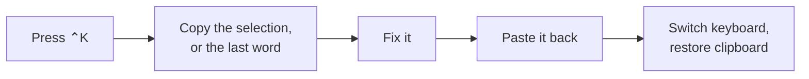

<div align="center">


# Sa7 | صح

**Fix text typed with the wrong keyboard layout, Arabic ↔ English, with one shortcut.**

A free macOS menu-bar app by Khaled Omar.

[](https://github.com/SunnysApartment/Sa7/releases/latest)
[](#requirements)
[](mac/Package.swift)
[](LICENSE)
[](https://github.com/SunnysApartment/Sa7/releases)

<a href="https://github.com/SunnysApartment/Sa7/releases/latest/download/Sa7.dmg"></a>

[Website](https://sunnysapartment.github.io/Sa7/) · [English](#overview) · [بالعربي](#بالعربي)

</div>

---

## Overview

You meant to type in Arabic, but the keyboard was set to English (or the other way round), and a sentence came out as gibberish. Instead of deleting it and typing it again, select it and press **⌃K**. Sa7 replaces it with what you meant and switches your keyboard to the right language, so the next words come out right.

| You typed | Sa7 gives you |
| --- | --- |
| `lvpfh` | `مرحبا` |
| `اثممخ` | `hello` |
| `hgsghl ugd;l` | `السلام عليكم` |
| `ezayak 3amel eh` (Franco) | `ازيك عامل ايه` |

> These examples use the **Arabic PC** layout. Sa7 reads the Arabic layout you actually have installed, so on a different Arabic layout the same keys produce different letters, and Sa7 follows your keyboard.

## Contents

- [Features](#features)
- [How it works](#how-it-works)
- [Installation](#installation)
- [Other ways to install](#other-ways-to-install)
- [First-run setup](#first-run-setup)
- [Usage and settings](#usage-and-settings)
- [Privacy and permissions](#privacy-and-permissions)
- [Requirements](#requirements)
- [Troubleshooting and FAQ](#troubleshooting-and-faq)
- [Uninstalling](#uninstalling)
- [Building from source](#building-from-source)
- [Project structure](#project-structure)
- [Testing](#testing)
- [Website](#website)
- [Roadmap](#roadmap)
- [Contributing](#contributing)
- [License](#license)
- [Author](#author)
- [بالعربي](#بالعربي)

## Features

- **One shortcut, any app.** Works in any app that supports copy and paste. The default shortcut is **⌃K**, and you can change it.
- **Selection or last word.** Fixes the selected text. If nothing is selected, it selects and fixes the last word you typed.
- **Automatic direction.** Detects whether the text should become Arabic or English. There is nothing to choose.
- **Undo.** Press ⌃K again right after a fix to put the text back the way it was.
- **Franco-Arabic.** Arabic written in Latin letters and numbers becomes Arabic script: `ezayak 3amel eh` → `ازيك عامل ايه`. Sa7 recognises Franco by itself when you press ⌃K.
- **Mixed text.** When a selection contains both Arabic and English, only the wrong words change. Sa7 checks each word against the macOS spelling dictionaries, and falls back to converting the whole selection when the dictionary can't decide.
- **Your own layouts.** Reads the keyboard layouts turned on in System Settings, including the Shift layer, so it works with the keys you actually have. Arabic, Persian and Urdu layouts pair with English or French AZERTY.
- **Caps Lock aware.** Text typed with Caps Lock on is converted as if Caps Lock were off.
- **Arabic details.** Lam-alef (`لا`, `لأ`, `لإ`, `لآ`) is treated as the single key it is, and marks such as shadda and harakat map key by key.
- **Switches the keyboard.** After a fix, the keyboard changes to the language you were typing in. You can turn this off.
- **Never-flip list.** Words Sa7 always leaves as they are, such as names and brands. You edit the list in Settings.
- **Confirmation bubble.** A small bubble near the text shows what was fixed, with an optional soft sound.
- **Fix clipboard.** A menu item that fixes the text on the clipboard, for apps that don't let you select text.
- **Off in chosen apps.** Turn Sa7 off in apps such as games or Terminal. There, ⌃K reaches the app as if Sa7 weren't running.
- **Typing hint (optional, off by default).** When it's on, Sa7 shows a small hint bubble, for example `مرحبا  ⌃K`, when it spots a word typed in the wrong keyboard. You press ⌃K to fix it. It never changes text by itself. See [Privacy and permissions](#privacy-and-permissions).
- **Leaves your clipboard alone.** Whatever you had copied is put back afterwards, and the temporary text Sa7 puts on the clipboard is marked so clipboard-history apps skip it.
- **Adobe apps.** In Adobe apps, Sa7 types the fixed text instead of pasting it, because their text tools don't take a pasted replacement reliably.
- **English or Arabic interface.** English by default, switchable at any time. In Arabic the setup window is laid out right to left.
- **Open at login**, if you want it to.
- **Settings window** with General, Never flip, Apps, Typing and Updates tabs. See [Settings](#settings).
- **Offline.** Sa7 never connects to the internet, unless you turn on the optional update check.
- **Chrome extension.** The same fixing in any text box in Chrome, including on Windows and Chromebooks. See [Other ways to install](#other-ways-to-install).

## How it works

When you press the shortcut, Sa7 runs this sequence. The shortcut fires when the key is released, and Sa7 waits for you to let go of the modifier keys so they don't mix with the keys it sends.



Press ⌃K again right away to undo. If something's missing (permission or keyboards), the setup window opens instead.

### 1. Reading the selection

- Sa7 first asks the focused app, through the Accessibility API, whether anything is selected. If the app reports an empty selection, Sa7 skips the copy, because some editors copy the whole line when ⌘C is pressed with nothing selected.
- Otherwise it sends ⌘C and waits up to half a second for the clipboard to change.
- If nothing was copied, it sends ⌥⇧← to select the last word, then copies that.

### 2. Reading your keyboards

Sa7 asks macOS (Text Input Sources) for the keyboard layouts you have turned on, and picks one English and one Arabic layout, preferring the one in use right now when several are on. For every typing key it asks macOS, through `UCKeyTranslate`, what the key types on each layout, without Shift and with Shift. Return, Tab and Space are skipped, and dead keys are ignored. The result is a two-way table: this key types `l` in English and `م` in Arabic. When two keys type the same character, the first one wins.

### 3. Converting the text

- **One language in the selection.** If there are more English letters than Arabic ones, the text is converted to Arabic; otherwise to English. If the result is the same as the input (digits, for example), nothing is changed.
- **Both languages in the selection.** The text is split into words, keeping the spacing as it was. A word is replaced only when it is not a real word as typed but is a real word once converted, according to the macOS spelling dictionary (punctuation around the word is ignored for the check). The keyboard switches to the language of the last word that was fixed.
- **Fallback.** If the dictionary for either language isn't available, or no word qualifies, Sa7 converts every character typed in the more common script and leaves the rest as it is.
- **Caps Lock.** If Caps Lock is on when you press the shortcut, letter case is inverted before converting. If Caps Lock is already off but the text is all capitals (two letters or more), it is treated as typed with Caps Lock on.
- **Two-character keys.** Keys that type two characters, like lam-alef, are matched as one unit in both directions.
- **Franco.** If the selection reads as Franco-Arabic (Latin letters, with digits such as `3` and `7` standing for Arabic letters), Sa7 writes it in Arabic script instead of mapping keys.
- **Never-flip words.** Words on your never-flip list are left exactly as typed.

### 4. Putting the fix back

- Sa7 writes the fixed text to the clipboard and sends ⌘V, then waits half a second so slower apps can read it. In apps whose bundle identifier starts with `com.adobe`, it types the text as Unicode key events instead.
- The temporary clipboard entry is marked with the `org.nspasteboard.TransientType` and `org.nspasteboard.AutoGeneratedType` markers, which clipboard managers such as Raycast, Paste and Maccy use to skip entries.
- If **Switch keyboard after fixing** is on, Sa7 selects the target layout.
- If the clipboard changed during the fix, every item and type that was on it before is restored.

Right after a fix, pressing the shortcut again undoes it and puts the original text back. In apps you've turned Sa7 off for, the shortcut goes to the app instead.

The menu-bar icon briefly shows the result: a filled check mark when text was fixed, a minus sign when there was nothing to fix or no text, and a warning sign when something needs setting up.

## Installation

### Fastest: one Terminal command

Open Terminal, paste this and press Return:

```bash
curl -fsSL https://sunnysapartment.github.io/Sa7/install.sh | bash
```

It downloads the latest release, checks its signature, puts Sa7 in Applications (or `~/Applications` if Applications isn't writable), and opens it. Files downloaded this way aren't flagged as coming from the internet, so macOS skips the unidentified-developer prompt. Run the same command again any time to update. You can [read the script](sa7-site/install.sh) first; it's under 30 lines.

### Or use the download

1. **[Download Sa7.dmg](https://github.com/SunnysApartment/Sa7/releases/latest/download/Sa7.dmg)**, open it, and drag **Sa7** to **Applications**.
2. Open Sa7 from Applications. macOS says it can't verify the developer, because the app isn't notarized yet.
3. Open **System Settings → Privacy & Security**, scroll down, and click **Open Anyway** next to the message about Sa7. Confirm.
4. The Sa7 setup window opens. Continue with [First-run setup](#first-run-setup).

If **Open Anyway** doesn't appear, remove the download quarantine flag in Terminal and open the app again:

```bash
xattr -cr /Applications/Sa7.app
```

Sa7 runs in the menu bar only. It has no Dock icon.

## Other ways to install

### Homebrew

```bash
brew install --cask sunnysapartment/sa7/sa7
```

`brew upgrade` updates it, and `brew uninstall --cask sa7` removes it. The first time, you still turn Sa7 on under Accessibility, as in [First-run setup](#first-run-setup).

### Chrome extension

The extension does the same fixing in any text box in Chrome, on Windows, Chromebooks and Macs. It isn't in the Chrome Web Store yet, so for now you load it from a zip:

1. Download **[Sa7-chrome.zip](https://github.com/SunnysApartment/Sa7/releases/latest/download/Sa7-chrome.zip)** from the latest release and unzip it.
2. Open `chrome://extensions` in Chrome and turn on **Developer mode** (top right).
3. Click **Load unpacked** and choose the unzipped folder.

To update, download the new zip, replace the folder, and click the reload button on the extension's card.

To fix text, select it (or put the cursor after a word) and press **Alt+Shift+K** (**⌥⇧K** on a Mac), or right-click and choose **Fix with Sa7**. The toolbar button opens a small try-box. You can change the shortcut at `chrome://extensions/shortcuts`. The extension only asks for access to the page you're on when you use it, and nothing leaves the browser. Its source is in [`chrome-extension/`](chrome-extension/).

## First-run setup

The setup window opens automatically when Sa7 is missing the Accessibility permission or can't find both keyboards. You can open it again at any time from the menu (**Setup and practice…**). It has four steps:

1. **Let Sa7 use the keyboard.** Click **Open Settings**, then turn Sa7 on under **Privacy & Security → Accessibility**. The window checks every second and updates by itself; you don't need to restart the app.
2. **Add an Arabic keyboard.** If Sa7 can't find one, open **System Settings → Keyboard → Text Input**, click **Edit**, and add Arabic. You also need an English layout such as ABC or U.S. Once both are found, the step shows their names, for example `ABC + Arabic`.
3. **Shortcut.** Shows the current shortcut. Click **Change shortcut** and press a new combination, or Esc to cancel. The shortcut must include ⌃, ⌥ or ⌘.
4. **Try it.** A practice field contains `hgsghl ugd;l`. Select all of it and press the shortcut; it becomes `السلام عليكم`. The window also shows the result of the last fix.

The language picker in the top corner switches the interface between English and Arabic.

## Usage and settings

1. Type as usual, even if the language is wrong.
2. Select the wrong text. To fix only the last word, don't select anything.
3. Press **⌃K** (or your own shortcut).

Click the menu-bar icon for these items:

| Menu item | What it does |
| --- | --- |
| Status line | The result of the last action, for example *Ready*, *Fixed*, *Nothing to fix* or *No text selected*. |
| **Fix clipboard** | Fixes the text on the clipboard, for apps that don't let you select text. Paste it where you need it. |
| **Switch keyboard after fixing** | On by default. After a fix, switches to the keyboard of the language you were typing in. |
| **Open Sa7 at login** | Registers Sa7 as a login item, using the system's login item service. |
| **Shortcut: ⌃K** | Shows the current shortcut and opens the setup window, where you can change it. |
| **Setup and practice…** | Opens the setup window. |
| **Settings…** | Opens the Settings window. |
| **Update to x.y** | Appears only when the update check is on and a newer version exists. Runs the official installer. |
| **Language** | English (default) or العربية. Applies to the menu and the setup window. |
| **Quit Sa7** (⌘Q) | Quits the app. |

### Settings

| Tab | What's in it |
| --- | --- |
| **General** | The shortcut, switching the keyboard after fixing, opening at login, the interface language, and the confirmation bubble and its sound. |
| **Never flip** | Words Sa7 always leaves alone, such as names and brands. Add or remove words here. |
| **Apps** | Apps where Sa7 is off, such as games or Terminal. In these apps the shortcut goes to the app as usual. |
| **Typing** | **Notice wrong words while I type.** Off by default. See [Privacy and permissions](#privacy-and-permissions). |
| **Updates** | **Check for updates.** Off by default. When a newer version exists, the menu shows *Update to x.y*, which runs the official installer. |

## Privacy and permissions

- **No network access by default.** Sa7 never connects to the internet unless you turn on **Check for updates** in Settings (off by default). With it on, Sa7 only asks whether a newer version exists; your text is never sent. Text is converted on your Mac and is not stored or logged.
- **What is stored.** Only Sa7's settings, in `~/Library/Preferences/com.khaledomar.sa7.plist`: the shortcut, whether to switch the keyboard, the interface language, your never-flip list, the apps Sa7 is off in, and the other options in Settings. The login item is managed by macOS.
- **Typing hint.** *Notice wrong words while I type* is off by default. When you turn it on, Sa7 looks only at the word you're typing right now, in memory, to spot one typed in the wrong keyboard. It stores nothing, sends nothing, and never changes text by itself: it shows a hint bubble, and you decide whether to press ⌃K. macOS may ask you to allow **Input Monitoring** for it. With the hint off, Sa7 doesn't read any text until you press the shortcut.
- **Why Accessibility permission.** To fix text in another app, Sa7 does what you would do by hand: it reads whether text is selected in the focused app, and it sends ⌘C, ⌥⇧← and ⌘V (or types the text in Adobe apps). macOS only allows an app to read another app's selection and send keystrokes to it with Accessibility permission.
- **Clipboard.** Your clipboard is saved before a fix and restored afterwards. The fixed text Sa7 places on the clipboard is marked as transient so clipboard-history apps skip it. The copy step itself (⌘C) is performed by the app you are typing in, so a clipboard manager may still record the original selection.

## Requirements

- macOS 14 Sonoma or later, on Apple silicon or Intel (the app is a universal binary).
- Two keyboard layouts turned on in **System Settings → Keyboard → Text Input**: an English layout (for example ABC or U.S.) or French AZERTY, and an Arabic, Persian or Urdu layout.
- Accessibility permission for Sa7.
- Input Monitoring permission, only if you turn on the typing hint and macOS asks for it.
- For the Chrome extension: Google Chrome on Windows, ChromeOS or macOS.
- For mixed-language selections: the macOS spelling dictionaries for English and Arabic. Without them, Sa7 converts the whole selection instead.

## Troubleshooting and FAQ

<details>
<summary><b>The shortcut does nothing, or Sa7 says the shortcut is used by another app.</b></summary>

Another app has already registered the same key combination. Sa7 shows *"⌃K is used by another app, pick another one"* in its menu. Open **Setup and practice…**, click **Change shortcut**, and choose a different combination that includes ⌃, ⌥ or ⌘.

</details>

<details>
<summary><b>I installed a new version and the shortcut stopped working.</b></summary>

From version 1.1.1 on, every release is signed with the same certificate, so updates keep the permission. If you're coming from an older version, macOS keeps the old permission record: Sa7 shows as switched on in **Privacy & Security → Accessibility**, but it no longer applies, and switching it off and on doesn't help. Open the setup window from the Sa7 menu and click **Reset permission** (1.2.1 or later), or run this in Terminal, then turn Sa7 on again when it asks:

```bash
tccutil reset Accessibility com.khaledomar.sa7
```

</details>

<details>
<summary><b>Sa7 says "Add an Arabic and an English keyboard".</b></summary>

Sa7 needs two layouts turned on: an Arabic, Persian or Urdu layout, and an English layout or French AZERTY. Open **System Settings → Keyboard → Text Input**, click **Edit**, and add what's missing. The setup window picks them up within a second.

</details>

<details>
<summary><b>I selected text with both languages and Sa7 flipped all of it.</b></summary>

Mixed text is fixed word by word only when the macOS dictionary can recognise the words. If no wrong word turns into a known word, or the Arabic or English dictionary isn't available, Sa7 falls back to converting everything typed in the more common script. Select only the wrong part and press the shortcut again.

</details>

<details>
<summary><b>Dialect words, names or slang aren't fixed in mixed text.</b></summary>

The macOS dictionary mostly knows standard spellings, so colloquial Arabic (for example Egyptian words), names and slang often aren't recognised as real words. Select only the wrong words, and Sa7 converts them directly without asking the dictionary.

</details>

<details>
<summary><b>The result has the wrong letters.</b></summary>

Sa7 converts using the layouts turned on in System Settings. If you have several English or Arabic layouts on, it prefers the one in use right now. Make sure the layouts turned on are the ones you actually type with; the setup window shows which pair Sa7 is using.

</details>

<details>
<summary><b>Nothing happens in a particular app.</b></summary>

Sa7 works through copy and paste. Apps or fields that don't allow copying (for example password fields) can't be fixed. If the app takes long to update the clipboard, Sa7 waits up to half a second before giving up and showing *No text selected*.

</details>

<details>
<summary><b>Sa7 changed a name or brand I wanted to keep.</b></summary>

Add the word to the **Never flip** list in Settings, and Sa7 leaves it alone from then on. Right after a fix, you can also press ⌃K again to undo it.

</details>

<details>
<summary><b>⌃K does nothing in one app, or does that app's own thing.</b></summary>

Check the **Apps** tab in Settings. In apps listed there Sa7 is off, and the shortcut goes to the app.

</details>

<details>
<summary><b>The typing hint never shows up.</b></summary>

Make sure **Notice wrong words while I type** is on in the **Typing** tab, and that Sa7 is allowed under **System Settings → Privacy & Security → Input Monitoring** if macOS asked.

</details>

<details>
<summary><b>Is it free? Is there a Windows version?</b></summary>

Sa7 is free and the source code is in this repository. There's no Windows app yet. On Windows and Chromebooks, use the [Chrome extension](#chrome-extension).

</details>

## Uninstalling

Installed with Homebrew? Run `brew uninstall --cask sa7`. Otherwise:

1. Quit Sa7 from its menu, and turn off **Open Sa7 at login** first if you had it on.
2. Delete `Sa7.app` from Applications.
3. Optionally remove its settings: `defaults delete com.khaledomar.sa7`
4. Optionally remove Sa7 from **System Settings → Privacy & Security → Accessibility**, and from **Input Monitoring** if you used the typing hint.

## Building from source

The Xcode Command Line Tools are enough; the full Xcode app is not required. The package targets macOS 14 and uses Swift tools version 5.10. The tests use the Swift Testing framework, which comes with Swift 6 toolchains (Xcode 16 or its Command Line Tools, or later).

```bash
git clone https://github.com/SunnysApartment/Sa7.git
cd Sa7/mac

swift test                       # run the converter tests
./build.sh                       # build mac/build.noindex/Sa7.app
DMG=1 ./build.sh                 # also package mac/build.noindex/Sa7.dmg
```

What `build.sh` does:

- Builds a release binary for both `arm64` and `x86_64`, and assembles `build.noindex/Sa7.app` with `Info.plist` and the app icon.
- Signs the app with the hardened runtime and verifies the signature.
- **`IDENTITY`** selects the signing identity (a name or SHA-1 hash from `security find-identity -p codesigning`). If unset, it picks, in order: a *Developer ID Application* identity, the project's self-signed **Khaled Omar (Sa7)** certificate, an *Apple Development* identity, and finally ad-hoc signing. A stable signature keeps the Accessibility permission across versions. `IDENTITY=-` forces ad-hoc signing.
- Official releases are signed with the self-signed **Khaled Omar (Sa7)** certificate. It's free and gives every version the same identity, but it isn't issued by Apple, so it doesn't replace notarization. Its private key lives only in the maintainer's keychain.
- With `DMG=1`, the script refuses to package a build whose certificate contains an email address, so personal details never end up in a public download.
- **`DMG=1`** also creates `build.noindex/Sa7.dmg` containing the app and a link to Applications.

`mac/.build/` and `mac/build/` are ignored by git.

## Project structure

```text
Sa7/
├── README.md
├── LICENSE                       MIT
├── chrome-extension/             Chrome extension (Manifest V3); build.sh makes dist/Sa7-chrome.zip
├── mac/                          macOS app (Swift Package)
│   ├── Package.swift             targets: Sa7Core, Sa7, Sa7CoreTests
│   ├── Info.plist                bundle id com.khaledomar.sa7, menu-bar only app
│   ├── build.sh                  universal build, signing, optional DMG
│   ├── Resources/
│   │   ├── Sa7.icns              app icon
│   │   ├── icon-1024.png
│   │   └── icon.svg
│   ├── Sources/
│   │   ├── Sa7Core/              conversion engine, no UI
│   │   │   ├── Converter.swift   direction, mixed text, Caps Lock, key mapping
│   │   │   ├── Keyboards.swift   reads installed layouts, switches keyboards
│   │   │   └── Spelling.swift    macOS spelling dictionary lookups
│   │   └── Sa7/                  the menu-bar app
│   │       ├── Sa7App.swift      app entry point and menu-bar item
│   │       ├── AppState.swift    settings, shortcut recording, status, setup window
│   │       ├── Fixer.swift       copy, convert, paste, clipboard restore
│   │       ├── Hotkey.swift      system-wide shortcut
│   │       └── Views.swift       menu and setup window (English and Arabic)
│   └── Tests/
│       └── Sa7CoreTests/
│           └── ConverterTests.swift
├── .github/workflows/pages.yml   publishes sa7-site/ to GitHub Pages
└── sa7-site/                     static website, English and Arabic
    ├── index.html                English (default)
    ├── ar/index.html             Arabic, right-to-left
    ├── install.sh                one-line installer served from the website
    ├── styles.css
    ├── script.js                 blackboard demo, keycaps, pointer tilt, try-it box
    ├── convert.js                browser version of the converter
    ├── franco.js                 Franco-Arabic to Arabic, for the try-it box
    ├── convert.test.js
    └── assets/                   favicon, chalk texture, social preview images
```

## Releasing

1. Bump `CFBundleShortVersionString` and `CFBundleVersion` in `mac/Info.plist` (and `version` in `chrome-extension/manifest.json`).
2. Build: `cd mac && DMG=1 ./build.sh` and `../chrome-extension/build.sh`.
3. Publish: `gh release create vX.Y.Z mac/build.noindex/Sa7.dmg chrome-extension/dist/Sa7-chrome.zip`. The website's download links and the one-line installer always point at the latest release.
4. Update the Homebrew cask in [SunnysApartment/homebrew-sa7](https://github.com/SunnysApartment/homebrew-sa7): set `version` and the new `sha256` (`curl -fsSL https://github.com/SunnysApartment/Sa7/releases/download/vX.Y.Z/Sa7.dmg | shasum -a 256`), run `brew style Casks/sa7.rb`, commit and push.

## Testing

```bash
(cd mac && swift test)                  # Swift tests (converter, Franco, languages, never-flip, undo, typing hint, versions)
(cd sa7-site && node convert.test.js)   # website converter tests
(cd sa7-site && node franco.test.js)    # Franco-Arabic tests (kept in sync with FrancoTests.swift)
node chrome-extension/test.js           # Chrome extension text-replacement tests
```

The converter tests (`mac/Tests/Sa7CoreTests/ConverterTests.swift`) cover:

- English keys to Arabic, including punctuation (`wp?` → `صح؟`).
- Arabic keys to English, lam-alef as one key, and shadda on its own key.
- The Shift layer and Caps Lock, both when Caps Lock is on and when all-capital text implies it was.
- Text with nothing to fix.
- Mixed text, where only the wrong words change, and the fallbacks when the dictionary can't decide.
- The macOS spelling dictionary.
- The keyboards installed on the machine running the tests. This test is skipped unless both an English and an Arabic layout are turned on.

## Website

`sa7-site/` is the project website, live at **https://sunnysapartment.github.io/Sa7/**. The English page is `index.html` and the Arabic page is `ar/index.html`; both share one stylesheet and script, and link to each other. Every push to `main` that touches `sa7-site/` republishes it through GitHub Pages (`.github/workflows/pages.yml`).

It is plain HTML, CSS and JavaScript with no build step and no dependencies; open `index.html` in a browser, or serve the folder with any static server, for example `python3 -m http.server` from inside `sa7-site/`. It loads its fonts from Google Fonts.

`convert.js` is a browser version of the converter, used by the animated demo and the try-it box. The try-it box also loads `franco.js`, and uses it instead of `convert.js` when the text looks like Franco. It differs from the app in two ways: it uses a fixed Arabic PC key table instead of the layouts installed on your Mac, and it has no dictionary, so mixed text is always converted by majority. Its tests run with `node convert.test.js`.

## Roadmap

- Notarization with Apple, so installing no longer needs **Open Anyway**.
- A Windows desktop app.
- A Chrome Web Store listing for the extension, so it installs and updates without Developer mode.

## Contributing

Bug reports and pull requests are welcome. When reporting a wrong conversion, include the text you typed, what you expected, and the keyboard layouts shown in the Sa7 setup window. Before opening a pull request, run `swift test` in `mac/`, and `node convert.test.js` in `sa7-site/` if you changed the website converter.

## License

Sa7 is open source under the [MIT License](LICENSE). You can use, change and share it, including in other projects, as long as the copyright notice stays with the code.

© 2026 Khaled Omar

## Author

Made by **Khaled Omar** ([SunnysApartment on GitHub](https://github.com/SunnysApartment)).

---

<div dir="rtl">

## بالعربي

### Sa7 | صح

كتبت بالكيبورد الغلط؟ حدّد الكلام واضغط **⌃K**، وSa7 يقلبه للي كنت تقصده بين العربي والإنجليزي، ويحوّل الكيبورد للغة الصح علشان اللي هتكتبه بعد كده يطلع صح. برنامج مجاني للماك، بيقعد في شريط القوايم فوق.

مثلاً: <code dir="ltr">lvpfh</code> ← <code>مرحبا</code>، و<code>اثممخ</code> ← <code dir="ltr">hello</code>

### بيعمل إيه

- بيشتغل في أي برنامج بتكتب فيه وبيقبل النسخ واللصق.
- لو محددتش حاجة، بيصلّح آخر كلمة كتبتها.
- بيعرف الاتجاه لوحده، من عربي لإنجليزي أو العكس.
- لو حددت كلام فيه اللغتين، بيصلّح الكلمات الغلط بس باستخدام قاموس الماك. لو القاموس مش عارف الكلمة، زي العامية، بيقلب الكلام المحدد كله، فساعتها حدّد الجزء الغلط بس.
- بيقرا الكيبورد اللي عندك انت، ومعاه Shift وCaps Lock: عربي أو فارسي أو أردو، مع إنجليزي أو فرنساوي AZERTY.
- بيحوّل الفرانكو لعربي: <code dir="ltr">ezayak 3amel eh</code> ← <code>ازيك عامل ايه</code>. بيعرفه لوحده لما تضغط **⌃K**.
- اضغط **⌃K** تاني على طول بعد التصليح، والكلام يرجع زي ما كان.
- بعد التصليح بيحوّل الكيبورد للغة الصح، وتقدر تقفل الخاصية دي من القايمة.
- بيرجّع اللي كنت ناسخه زي ما كان، ومش بيملا سجل الحافظة عندك.
- بيوريك التصليح في فقاعة صغيرة جنب الكلام، ومعاها صوت هادي لو حبيت.
- فيه قايمة كلمات عمره ما يقلبها، زي الأسامي والماركات، بتعدّلها من الإعدادات.
- تقدر تقفله في برامج معينة، زي الألعاب أو Terminal، وساعتها **⌃K** يروح للبرنامج عادي.
- فيه "Fix clipboard" في القايمة، بيصلّح الكلام اللي نسخته، للبرامج اللي مبتخليكش تحدد الكلام.
- لو فعّلت التنبيه وانت بتكتب، بيطلّعلك فقاعة صغيرة لما كلمة تطلع بالكيبورد الغلط، وانت تضغط **⌃K** تصلّحها. مقفول من الأول.
- كل إعداداته في شاشة واحدة فيها General وNever flip وApps وTyping وUpdates. الاختصار تقدر تغيّره، والبرنامج نفسه عربي أو إنجليزي.

### التحميل والتثبيت

**الأسرع:** افتح Terminal، الصق الأمر ده واضغط Return. هيحط البرنامج في Applications ويفتحه من غير أي تحذير، وشغّله تاني في أي وقت علشان تحدّث:

<div dir="ltr">

```bash
curl -fsSL https://sunnysapartment.github.io/Sa7/install.sh | bash
```

</div>

**أو** [حمّل Sa7 للماك](https://github.com/SunnysApartment/Sa7/releases/latest/download/Sa7.dmg) (محتاج macOS 14 أو أحدث). الماك هيحذرك أول مرة علشان البرنامج لسه مش موقّع من Apple. الخطوات دي بتعدّيك من التحذير:

1. افتح Sa7.dmg اللي نزل، واسحب Sa7 على Applications.
2. افتح Sa7 من Applications. الماك هيقولك إنه مش قادر يتأكد من المطوّر.
3. روح System Settings، وبعدين Privacy & Security، وانزل واضغط Open Anyway.
4. هتظهر شاشة Sa7. اضغط افتح الإعدادات وفعّل Sa7 تحت Accessibility. الشاشة هتتحدّث لوحدها، من غير ما تقفل البرنامج.

الزرار مش ظاهر؟ شغّل الأمر ده في Terminal، وافتح البرنامج تاني:

<div dir="ltr">

```bash
xattr -cr /Applications/Sa7.app
```

</div>

محتاج كيبورد إنجليزي (ABC أو US أو الفرنساوي AZERTY) وكيبورد عربي أو فارسي أو أردو. ضيفهم من System Settings، في Keyboard، تحت Text Input.

نزّلت نسخة جديدة والاختصار وقف؟ من نسخة 1.1.1 وطالع التحديثات بتحافظ على الصلاحية. لو جاي من نسخة أقدم، الماك بيفضل مبيّن Sa7 متفعّل وهو مش شغّال، وتقفيله وفتحه مش بيحل. افتح شاشة الإعداد من قايمة Sa7 واضغط **صفّر الصلاحية**، أو شغّل الأمر `tccutil reset Accessibility com.khaledomar.sa7` في Terminal، وبعدين فعّل Sa7 تاني.

### طرق تانية للتثبيت

**من Homebrew:**

<div dir="ltr">

```bash
brew install --cask sunnysapartment/sa7/sa7
```

</div>

**إضافة كروم:** بتعمل نفس التصليح في أي مربع كتابة في كروم، على ويندوز والكروم بوك والماك. لسه مش موجودة على Chrome Web Store، فبتضيفها من ملف zip دلوقتي:

1. نزّل [Sa7-chrome.zip](https://github.com/SunnysApartment/Sa7/releases/latest/download/Sa7-chrome.zip) وفُكّ الضغط.
2. افتح <code dir="ltr">chrome://extensions</code> في كروم، وشغّل Developer mode.
3. اضغط Load unpacked واختار الفولدر اللي فكّيته.

### الخصوصية

- Sa7 مبيتصلش بالنت خالص، إلا لو فعّلت التشييك على التحديثات من الإعدادات (مقفول من الأول). وساعتها بيسأل بس لو فيه نسخة أحدث، واللي بتكتبه مبيتبعتش لأي مكان ولا بيتحفظ.
- التنبيه وانت بتكتب مقفول من الأول. لو فعّلته، بيبص بس على الكلمة اللي بتكتبها دلوقتي، في الذاكرة، ومبيحفظش أي حاجة، وعمره ما بيغيّر كلامك لوحده. الماك ممكن يطلب منك صلاحية Input Monitoring علشانه.
- اللي بيتحفظ بس هو إعداداته، زي الاختصار واللغة وقايمة الكلمات اللي متتقلبش، على جهازك في <code dir="ltr">~/Library/Preferences/com.khaledomar.sa7.plist</code>.
- بيطلب صلاحية Accessibility علشان ينسخ الكلام المحدد ويلصق الصح مكانه، زي ما انت بتعمل بإيدك.

</div>
